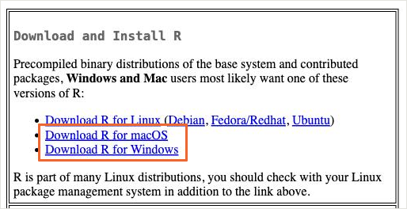
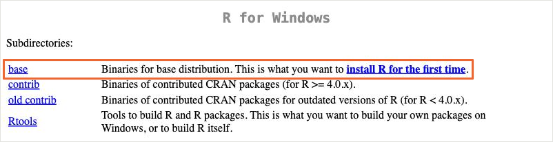
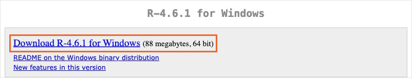
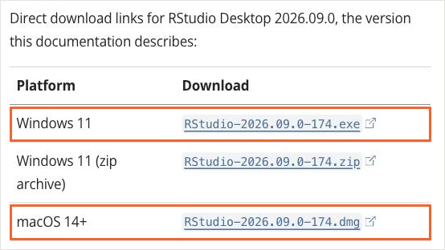

::: {.duyuru}
```{=html}
<div class="duyuru-video">
  <iframe src="https://www.youtube-nocookie.com/embed/cc22iYSFUmw?rel=0" title="Oturum 1 ders kaydı, 16 Ekim 2026" loading="lazy" allow="accelerometer; clipboard-write; encrypted-media; gyroscope; picture-in-picture; web-share" referrerpolicy="strict-origin-when-cross-origin" allowfullscreen></iframe>
</div>
```

::: {.duyuru-metin}
[Duyuru]{.duyuru-etiket}

**İlk oturumun kaydı yayında.** 16\ Ekim'deki oturuma katılamadıysanız ya da bir bölümü yeniden görmek istiyorsanız kaydı izleyebilirsiniz.

[Kaydı YouTube'da açın](https://www.youtube.com/watch?v=cc22iYSFUmw&list=PLVqkPXX13dHk){.duyuru-baglanti}
:::
:::

## Başlamadan önce

Oturuma katılmadan önce bilgisayarınızı hazırlayın. Aşağıdaki beş adım yaklaşık 15–20 dakika sürer. Mac ya da Windows kullandığınıza göre ilgili sekmeyi seçin.

:::::: {.adimlar}
::::: {.adim}
[1]{.adim-no}

[R'ı indirip kurun]{.adim-baslik}

R, kodlarımızı çalıştıran programdır. Önce bunu kurun.

1. [cran.r-project.org](https://cran.r-project.org) adresini açın.
2. Sayfanın üstündeki kutuda bilgisayarınıza uygun bağlantıya tıklayın: Mac için **Download R for macOS**, Windows için **Download R for Windows**.

{.ekran fig-alt="CRAN ana sayfasının üst kısmı. Download R for macOS ve Download R for Windows bağlantıları turuncu çerçeveyle işaretlenmiş."}

:::: {.panel-tabset}
## Mac

3. Açılan sayfada **Latest release** başlığının altındaki kurulum dosyasını indirin:
    - Apple işlemcili Mac (M1, M2, M3, M4): adı **arm64** ile biten dosya, örneğin `R-4.6.1-arm64.pkg`.
    - Intel işlemcili Mac: adı **x86_64** ile biten dosya. Bu dosya sayfanın biraz aşağısındadır.

    İşlemcinizi öğrenmek için ekranın sol üstündeki Apple menüsünden **Bu Mac Hakkında**'yı açın. "Çip" satırında Apple M… yazıyorsa arm64 dosyasını seçin.

{.ekran fig-alt="CRAN macOS sayfasında For Apple silicon satırı ve R-4.6.1-arm64.pkg bağlantısı turuncu çerçeveyle işaretlenmiş."}

4. İndirilen `.pkg` dosyasına çift tıklayın. Kurulum penceresinde sırayla **Sürdür**, **Kabul Et** ve **Yükle** düğmelerine basın. Mac parolanız istenebilir.

| Mac şunu sorarsa | Yapmanız gereken |
|----------|----------|
| Yükleyici, **İndirilenler** klasörüne erişmek istiyor | **İzin Ver**'e basın. İzin vermezseniz kurulum başlamaz. |
| Bu sürümün macOS 14 (Sonoma) ya da sonrasını gerektirdiği | Apple işlemcili bütün Mac'ler macOS 14'e güncellenebilir. Önce **Sistem Ayarları > Genel > Yazılım Güncelleme**'den macOS'u güncelleyin. |

## Windows

3. Açılan sayfada **base** bağlantısına tıklayın.

{.ekran fig-alt="CRAN R for Windows sayfasında base satırı ve install R for the first time bağlantısı turuncu çerçeveyle işaretlenmiş."}

4. Sayfanın en üstündeki **Download R-4.x.x for Windows** bağlantısına tıklayıp kurulum dosyasını indirin.

{.ekran fig-alt="R-4.6.1 for Windows sayfasında Download R-4.6.1 for Windows bağlantısı turuncu çerçeveyle işaretlenmiş."}

5. İndirilen `.exe` dosyasını açın. Kurulumdaki bütün seçenekleri olduğu gibi bırakın. **İleri** ile ilerleyin, en sonda **Son**'a basın.

| Windows şunu sorarsa | Yapmanız gereken |
|----------|----------|
| "Bu uygulamanın cihazınızda değişiklik yapmasına izin vermek istiyor musunuz?" | **Evet**'e basın. |
| Kurulum dili | Türkçe ya da İngilizce seçebilirsiniz; ikisi de olur. |
| Kurulacak bileşenler ve başlangıç seçenekleri | Hiçbir şeyi değiştirmeyin, **İleri**'ye basın. |
::::

R'ı kurduktan sonra açmanız gerekmez. RStudio, R'ı kendisi kullanır.
:::::

::::: {.adim}
[2]{.adim-no}

[RStudio'yu indirip kurun]{.adim-baslik}

RStudio, R ile çalışmayı kolaylaştıran programdır. Kodu bu programda yazacağız. R kurulu değilse RStudio çalışmaz; bu yüzden önce 1. adımı bitirin.

1. [RStudio Desktop](https://posit.co/download/rstudio-desktop/) sayfasını açın. Bağlantı sizi RStudio'nun kullanım kılavuzuna götürür.
2. Sayfada **Direct Downloads (Open Source)** başlıklı tabloyu bulun. Windows için `.exe`, Mac için `.dmg` ile biten dosyayı indirin.

{.ekran fig-alt="RStudio Desktop doğrudan indirme tablosunda Windows 11 için .exe ve macOS 14+ için .dmg satırları turuncu çerçeveyle işaretlenmiş."}

:::: {.panel-tabset}
## Mac

3. İndirilen `.dmg` dosyasına çift tıklayın. Açılan pencerede RStudio simgesini **Uygulamalar** (Applications) klasörüne sürükleyin.
4. RStudio'yu **Uygulamalar** klasöründen açın.

İlk açılışta Mac size birkaç soru sorabilir:

| Mac şunu sorarsa | Yapmanız gereken |
|----------|----------|
| "RStudio internetten indirilmiş bir uygulama. Açmak istediğinizden emin misiniz?" | **Aç**'a basın. |
| RStudio, **Belgeler**, **Masaüstü** ya da **İndirilenler** klasörüne erişmek istiyor | **İzin Ver**'e basın. Ders klasörünüz bu klasörlerden birindeyse RStudio onu ancak böyle açabilir. |
| "Komut satırı geliştirici araçları" (command line developer tools) kurulsun mu? | **Şimdi Değil**'e basabilirsiniz. Bu eğitim için gerekmez. |

## Windows

3. İndirilen `.exe` dosyasını açın. "Değişiklik yapmasına izin vermek istiyor musunuz?" sorusuna **Evet** deyin.
4. Seçenekleri olduğu gibi bırakın. **İleri**, ardından **Yükle** ve en sonda **Son**'a basın.
5. RStudio'yu Başlat menüsünden açın.
::::

::: {.callout-note appearance="simple"}
RStudio'nun güncel sürümü **Windows 11** ve **macOS 14 (Sonoma)** ya da daha yenisinde çalışır. Bilgisayarınızda daha eski bir sürüm varsa oturuma yine katılın. Kodu [Tarayıcıda deneyin](oturum2-dene.qmd) sayfasında kurulum yapmadan çalıştırabilirsiniz.
:::
:::::

::::: {.adim}
[3]{.adim-no}

[Ders klasörünü indirin]{.adim-baslik}

[`R_egitim.zip`](indir/R_egitim.zip) dosyasını indirin. Bu dosyada oturumda kullanacağımız kod ve veri var.
:::::

::::: {.adim}
[4]{.adim-no}

[Zip dosyasını açın]{.adim-baslik}

:::: {.panel-tabset}
## Mac

İndirdiğiniz `R_egitim.zip` dosyasına çift tıklayın. Yanında `R_egitim` adlı bir klasör oluşur.

## Windows

`R_egitim.zip` dosyasına sağ tıklayın ve **Tümünü ayıkla**'yı seçin. Açılan pencerede **Ayıkla**'ya basın. Zip dosyasına yalnızca çift tıklarsanız içine bakarsınız ama dosyalar çıkarılmaz; RStudio bu durumda projeyi açamaz.
::::

`R_egitim` klasörünü **Belgeler** gibi kolay bulacağınız bir yere taşıyın.

- Klasörün adını değiştirmeyin.
- Klasörün bulunduğu yolda Türkçe karakter ve boşluk olmasın.
- Klasörü OneDrive ile eşitlenen bir yere koymayın.
:::::

::::: {.adim}
[5]{.adim-no}

[Projeyi açın]{.adim-baslik}

`R_egitim` klasöründeki `R_egitim.Rproj` dosyasına çift tıklayın. RStudio bu klasörde açılır. Sağ alttaki **Files** panelinde `oturum1_ilk_adim.R` dosyasını görüyorsanız hazırsınız.
:::::
::::::

Şimdilik paket kurmanız gerekmez. Gereken paketleri oturumlarda, ihtiyaç oldukça birlikte kuracağız.

::: {.callout-tip}
## Kurulum olmazsa

Oturuma yine katılın. Ekranı izleyerek takip edebilirsiniz. Kodu kurulum yapmadan [Tarayıcıda deneyin](oturum2-dene.qmd) sayfasında da çalıştırabilirsiniz.
:::

## İkinci oturum: dağınık veriyi temizlemek

[23 Ekim 2026]{.ust-etiket}

Bu oturumun sonunda şunları yapabileceksiniz:

- Sahadan gelen dağınık bir Excel dosyasını doğru ayarlarla okumak.
- Veriyi LLM'e göstermeden, yalnız özetini paylaşarak yardım istemek.
- `|>` ve dplyr fiilleriyle satır ve sütun seçmek, yeni sütun oluşturmak.
- Farklı yazılmış kategorileri birleştirmek; metin olarak okunan sayıları ve tarihleri düzeltmek.
- Akla yatkın olmayan değerleri ve tekrar eden kayıtları bulmak.
- Her düzeltmeyi kontrol etmek ve kararları kaydetmek.

Oturumda, ilk oturumdaki hipertansiyon taramasının sahadan gelmiş, dağınık Excel halini kullanacağız. Bu veri eğitim için üretildi; gerçek kişilere ait değildir.

::: {.cipler}
[`Genel bakış` oturumun akışı ve bölümleri](oturum2.qmd){.cip}
[`Kodlar ve çıktıları` R'da çalıştırıldığında nasıl görünür](oturum2-kod.qmd){.cip}
[`webR` R'ı tarayıcıda deneyin!](oturum2-dene.qmd){.cip}
:::

İlk oturumun kodları, kaydı ve verisi üst menüde, **Oturum 1** altında.
